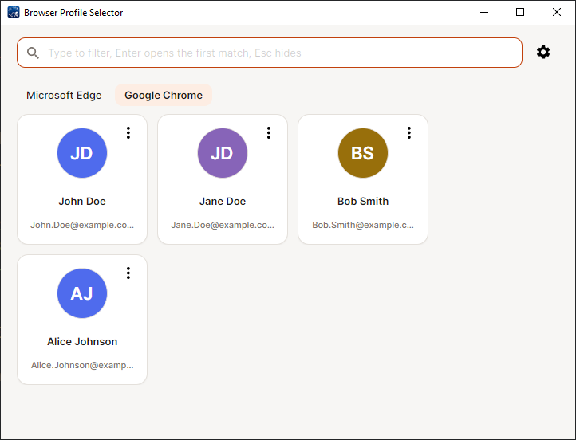
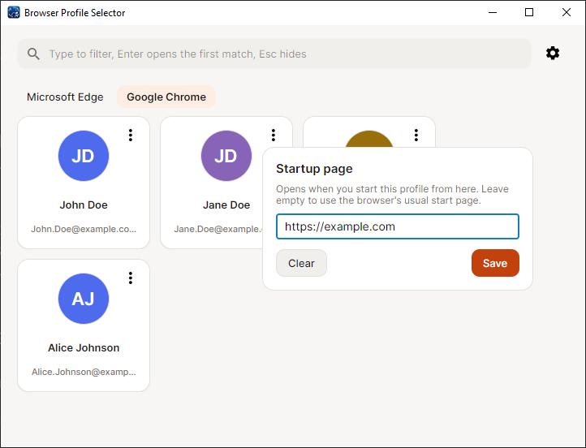
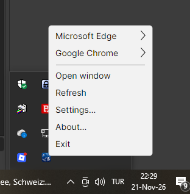
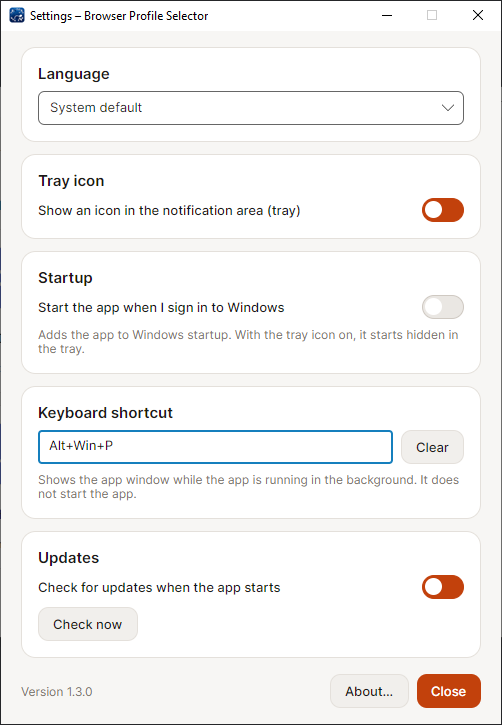

# Browser Profile Selector

Lists your browser profiles and opens the browser in the one you click.
Supports Microsoft Edge and Google Chrome; Opera and other Chromium browsers are planned.
Lives in the system tray (a menu with one entry per profile) and has a launcher window with profile tiles.

Built with .NET 10 and Avalonia 11. Works on Windows; macOS and Linux paths are implemented but untested.

## UI

### Main Window

This is the main window. It shows all your profiles for Edge and Chrome ordered by name.

### Startup Page

For each profile you can define a startup page.

### Tray menu

When you close the main window Browser Profile Selector still lives in the tray. - With a left click you can open the main window. - With a right click you can open the tray menu and select one of the options.

### Settings

There are multiple settings you can tweek.

- Define a keyboard shortcut to open the main menu. Handy to start quickly.
- Select a default language for your UI.
- Choose if want to start the app when OS starts.
- Choose if want to have a tray icon.

## Use

- Click a tile to open the browser with that profile.
- Type to filter, **Enter** opens the first match, **Esc** hides the window.
- Closing the window keeps the app in the tray; use tray **Exit** to quit.
- Start with `--tray` to start hidden in the tray.
- Rightclick on tray icon opens a menu with all profiles.

## License

Freeware, Copyright © 2026 OfficePuma. You may use the app free of charge and pass on unmodified copies free
of charge; modifying, reverse engineering and selling it are not permitted. See [LICENSE.txt](LICENSE.txt).
Third-party components and their licenses are listed in [THIRD-PARTY-NOTICES.txt](THIRD-PARTY-NOTICES.txt).
Both files ship in every release zip and are shown in the app under **Settings → About…** (also in the tray menu).

Browser Profile Selector is an independent product and is not affiliated with, endorsed or sponsored by any browser
vendor. All product names and trademarks are the property of their respective owners.

## Languages

- Chinese
- Danish
- Dutch
- English
- German
- French
- Hindi
- Italian
- Korean
- Polnish
- Spanish
- Swedish
- Turkish
- Vietnamese

## Updates

At startup the app asks GitHub for the latest release (drafts and pre-releases are ignored). If it's newer, a banner
appears in the window and an "Update available" entry at the top of the tray menu; **Download** opens the release
page in the browser. The banner's ✕ hides it until the next version comes out.

## Variants

All are a single `BrowserProfileSelector.exe`; no installer.

## Downloads

[Release](https://github.com/officepuma/browser-profile-selector-installers/releases)
